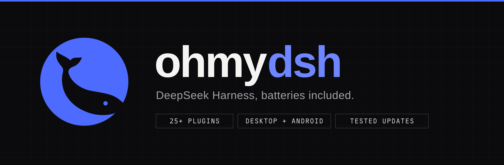

<p align="center">
  
</p>

<p align="center">
  <b>An opinionated, batteries-included setup for <a href="https://github.com/deepseek-ai/deepseek-harness">DeepSeek Harness</a>.</b><br>
  One command gives you a studio, a phone app, memory, a live browser, notebooks, automations and 20+ more plugins, wired together and tested as one.
</p>

<p align="center">
  <a href="#install">Install</a> ·
  <a href="#whats-inside">What's inside</a> ·
  <a href="#updating">Updating</a> ·
  <a href="#how-it-works">How it works</a> ·
  <a href="#contributing">Contributing</a>
</p>

<p align="center">
  
  
  
</p>

---

DeepSeek Harness is a plugin framework: the core is small and everything else is a plugin. That's great for builders, but a fresh install is bare, and putting together a good setup means finding, vetting, configuring and updating dozens of plugins yourself.

**ohmydsh is that work, done once.** It is the setup we use every day, packaged so you can install it in one line, update it in one command, and roll back if an update ever misbehaves. Think [oh-my-zsh](https://ohmyz.sh) or [oh-my-pi](https://github.com/can1357/oh-my-pi), for DeepSeek Harness.

> [!NOTE]
> DeepSeek Harness is in developer preview. ohmydsh pins one tested DSH release and only moves to a new one after the whole set passes its checks.

## Install

> [!IMPORTANT]
> **Work in progress.** The installer and the `omd` command are being built now; the commands below don't work yet. Until then, the plugins are available one by one from their [release pages](https://github.com/deestax?tab=repositories&q=dsh-). See [docs/DESIGN.md](docs/DESIGN.md) for the plan. From a checkout, `pnpm install && node packages/cli/bin/omd.js setup --dev` already works.

```sh
curl -fsSL https://raw.githubusercontent.com/T3-Venture-Labs-Limited/ohmydsh/main/install.sh | sh
```

Then start it:

```sh
omd            # opens the web UI
```

What the installer does:

1. Checks for Node.js 24 and installs the pinned DeepSeek Harness version if you don't have it.
2. Creates a separate DSH profile called **`omd`**. Your existing `web` profile, sessions and settings are left alone.
3. Installs the core plugin set into that profile, at versions that were tested together.
4. Runs `omd doctor` and tells you what still needs you (a model login, optional API keys).

Prefer to look before you run? Read [`install.sh`](install.sh) first, or install by hand:

```sh
npm install -g @ohmydsh/cli
omd setup
```

### Apps

Prefer an app to a terminal? ohmydsh ships a **desktop app** and an **Android app** that links to it by QR code.

> [!NOTE]
> **Coming with the first release.** The download buttons below start working when the first version tag is built. See [docs/APPS.md](docs/APPS.md) for everything, including how to build them today.

<p align="center">
  <a href="https://github.com/T3-Venture-Labs-Limited/ohmydsh/releases/latest"></a>
  <a href="https://github.com/T3-Venture-Labs-Limited/ohmydsh/releases/latest"></a>
  <a href="https://github.com/T3-Venture-Labs-Limited/ohmydsh/releases/latest"></a>
  <a href="https://github.com/T3-Venture-Labs-Limited/ohmydsh/releases/latest"></a>
</p>

- **Desktop** (Windows, macOS, Linux): DSH and the plugin set in their own window, with a tray icon. No Node, no terminal. The first start installs everything (a few minutes).
- **Android**: open **Settings → Phone app → Pair a phone** in DSH, scan the QR code with the ohmydsh app, and your computer's DSH opens full-screen on the phone, over Tailscale or your Wi-Fi.
- The desktop builds are **not code-signed yet**, so Windows and macOS ask you to confirm the first start: [how](docs/APPS.md#installing-the-desktop-app).

## What's inside

Everything below is installed and enabled by default unless marked *optional*.

### Built by us

| | Plugin | What it does |
|---|---|---|
| 🎨 | **Studio** | A personal image and video studio: generate, edit, inpaint, outpaint, upscale, animate. Its gallery also collects every image and video your agent makes in any chat. |
| 📱 | **Phone app** | Install DSH on your phone as an app, with push notifications for approvals, questions and finished replies, and a share target. |
| 🖱️ | **Browser takeover** | Watch the agent's browser live and take control to sign in or solve a captcha, then hand it back. |
| 💬 | **Review comments** | Highlight text in a doc, PDF, deck, sheet, code file or chat reply and leave a comment for the agent. |
| 🧠 | **Skill studio** | See, edit and switch off agent skills; the agent can propose new skills for you to approve. |
| 📓 | **Notebook** | Jupyter notebooks in the sidebar, sharing one kernel between you and the agent. |
| ⚡ | **Triggers** | Event automations: a webhook, a new file or a Composio event opens a chat that runs a prompt. |
| 💸 | **Automation models** | Scheduled tasks and background wake-ups run on a cheaper model, then switch back. |

### Hand-picked from the community

| Area | Plugins |
|---|---|
| Models and memory | `dsh-plugin-subscriptions` (use your ChatGPT, Claude, Grok, Copilot or Google subscription), `@kenz1117/dsh-engram` (long-term memory), `dsh-context`, `dsh-model-logos` |
| Workspace | `dsh-better-sidebar`, `@changfenhuang/dsh-genui`, `dsh-marktext`, `@orderg-x/dsh-video-preview`, `@zseven-w/dsh-openpencil`, `dsh-output-styles` |
| Keyboard | `dsh-composer-history`, `@hellokidder/dsh-hotkey` |
| Automation | `dsh-sentinel`, `dsh-notify-me` |
| Browser | `dsh-agent-browser` |

Every community plugin is used as published and credited to its authors. Where we needed a fix, we sent it upstream first.

### Optional packs

Some plugins only make sense if you use a particular service or desktop. Add them when you want them:

```sh
omd add composio     # Composio apps and triggers (needs the Composio CLI)
omd add langfuse     # Langfuse tracing for every agent turn (needs Langfuse keys)
omd add parallel     # web search and fetch through Parallel (needs PARALLEL_API_KEY)
omd add omarchy      # follow your Omarchy theme + a floating quick-prompt HUD
```

## Updating

```sh
omd update           # move to the newest tested set
omd rollback         # go back to the previous set
omd doctor           # check that everything is installed and healthy
```

`omd update` installs a new set into a fresh copy of your profile, checks that DSH starts with it, and only then switches over. If anything fails, nothing changes. Your sessions, settings, logins and anything you added yourself are never touched.

Plugins you install on top of ohmydsh stay yours: `omd update` keeps them and only manages the ones it installed.

## Commands

```text
omd                  start the web UI (same as: dsh omd)
omd setup            first-time install, or repair an existing install
omd add <pack>       add an optional pack
omd remove <pack>    remove an optional pack
omd update           update to the newest tested set
omd rollback         return to the previous set
omd doctor           health check: versions, plugins, logins, keys
omd list             show installed plugins and versions
```

## How it works

ohmydsh is a thin layer over DeepSeek Harness, not a fork.

- **One manifest decides everything.** [`ohmydsh.json`](ohmydsh.json) lists the DSH version and the exact version of every plugin, ours and the community's. A release of ohmydsh is just a new tested version of that file.
- **Our plugins live in this repo** under [`packages/`](packages), built and released together. Each is also published to npm as `@ohmydsh/<name>`, so DSH's own plugin page can show and update it.
- **Community plugins stay upstream.** They're installed from npm at the pinned version. When we need a change, we open a pull request there rather than keep a fork.
- **A profile, not a patch to your system.** Everything goes into the `omd` DSH profile, configured by one layered settings file, with your own overrides kept in a separate file that updates never rewrite.
- **Tested as a set.** CI installs the whole manifest into a clean profile, boots DSH, and checks that every plugin loads before a release is published. A weekly job tries the newest community versions and opens a pull request when they pass.

```text
DeepSeek Harness (pinned)
  └─ profile "omd"
       ├─ ohmydsh defaults           ← from this repo, replaced on update
       ├─ plugins from ohmydsh.json  ← ours + community, exact versions
       └─ your overrides             ← never touched by updates
```

## Repository layout

```text
ohmydsh/
├─ install.sh            one-line installer
├─ ohmydsh.json          the tested set: DSH version + every plugin version
├─ packages/
│  ├─ cli/               the `omd` command
│  ├─ kit/               shared UI kit used by our plugins
│  ├─ studio/  pwa/  notebook/  triggers/  …   our plugins
├─ profile/              default settings for the omd profile
└─ assets/               logo and artwork
```

## Contributing

Issues and pull requests are welcome. A change to one plugin is a pull request against this repo; CI tests it together with the rest of the set. See [CONTRIBUTING.md](CONTRIBUTING.md).

If you've built a DSH plugin you think belongs in the default set, open an issue with a link to it.

## Credits

ohmydsh exists because of the people who built DeepSeek Harness and the community plugins it ships. Each plugin keeps its own licence; see [NOTICE](NOTICE).

Made by [T3 Venture Labs](https://github.com/T3-Venture-Labs-Limited). Not affiliated with or endorsed by DeepSeek.

## License

[MIT](LICENSE)
