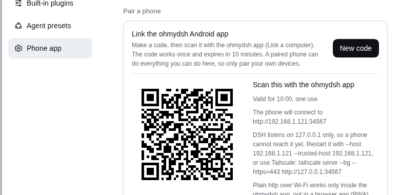

# ohmydsh apps

Two apps, one idea: run DeepSeek Harness on your computer, and reach it from a window or from your phone without thinking about tokens, ports or Node.

| | What it is | Where |
|---|---|---|
| **Desktop** (Windows, macOS, Linux) | A native window around your own DSH, with the whole ohmydsh plugin set. Nothing to install first: it carries its own Node. | [`apps/desktop`](../apps/desktop) |
| **Android** | A small app that links to the DSH on your computer by QR code, then shows the normal DSH UI full-screen. | [`apps/android`](../apps/android) |

> [!NOTE]
> **Coming with the first release.** The apps are built by CI as the last step of a release: pushing a `v*` tag runs [`release.yml`](../.github/workflows/release.yml), which publishes the npm packages, creates the GitHub Release and then calls [`apps.yml`](../.github/workflows/apps.yml) to attach the apps. Until the first `v*` tag exists, the links below point at an empty Releases page. You can build both from a checkout today (see [Building](#building)).

## Download

Everything is attached to the [latest release](https://github.com/T3-Venture-Labs-Limited/ohmydsh/releases/latest), with a `SHA256SUMS.txt` next to it.

| Platform | File |
|---|---|
| Windows 10/11 (x64) | `ohmydsh-<version>-win-x64-setup.exe` |
| macOS, Apple Silicon | `ohmydsh-<version>-mac-arm64.dmg` |
| macOS, Intel | `ohmydsh-<version>-mac-x64.dmg` |
| Linux (any distro) | `ohmydsh-<version>-linux-x86_64.AppImage` |
| Linux (Debian, Ubuntu) | `ohmydsh-<version>-linux-amd64.deb` |
| Android 8.0+ | `ohmydsh-<version>-android.apk` |

Check a download: `sha256sum -c SHA256SUMS.txt --ignore-missing` (Linux), `shasum -a 256 -c SHA256SUMS.txt --ignore-missing` (macOS), `Get-FileHash <file>` (Windows).

## Installing the desktop app

**The desktop builds are not code-signed yet.** Signing needs a Windows code-signing certificate and an Apple Developer ID, which we do not have. Until then your system will warn you, and you decide whether to trust the file (compare it with `SHA256SUMS.txt`).

### Windows

1. Run the `.exe`. SmartScreen says "Windows protected your PC".
2. Click **More info**, then **Run anyway**.
3. Pick an install folder (or keep the default) and finish. ohmydsh starts and sits in the system tray.

### macOS

1. Open the `.dmg` and drag **ohmydsh** to Applications.
2. The first start is refused ("cannot be opened because the developer cannot be verified"). Either **right-click the app, choose Open, then Open** in the dialog, or run once in a terminal:
   ```sh
   xattr -dr com.apple.quarantine /Applications/ohmydsh.app
   ```
3. Later starts need no workaround.

### Linux

- **AppImage**: `chmod +x ohmydsh-*.AppImage && ./ohmydsh-*.AppImage`. It needs FUSE 2 (`libfuse2`); without it run it with `--appimage-extract-and-run`.
- **.deb**: `sudo apt install ./ohmydsh-*.deb`.

### First start

The first launch downloads and installs DeepSeek Harness and the plugin set into the app's own data folder. It takes a few minutes and about 1.5 GB of disk. A progress screen shows what it is doing; if it fails (no network, disk full) it says why and offers **Try again**. After that, starting is instant.

| | |
|---|---|
| App data (own DSH home) | Windows `%APPDATA%\ohmydsh\dsh-home`, macOS `~/Library/Application Support/ohmydsh/dsh-home`, Linux `~/.config/ohmydsh/dsh-home` |
| Log | `…/ohmydsh/logs/ohmydsh.log` (tray → *Open the log*). Tokens are never written to it. |
| Settings | `…/ohmydsh/settings.json` |

The app does **not** touch an existing `~/.dsh`. To use an existing DSH home instead, start the app with `OHMYDSH_DSH_HOME=/path/to/home` (it then installs the `omd` profile into that home).

### What it does

- Starts `dsh omd` (on the bundled Node) as a child process on **127.0.0.1:43080** (a fixed port, so a paired phone keeps working across restarts) and opens it in its window. The launch token never appears on screen.
- One instance only. **Closing the window keeps DSH running** (agents keep working, the phone stays connected); the tray icon has **Open**, **Pair phone…**, **Restart DeepSeek Harness**, **Open the log**, **Check for updates…** and **Quit** (which stops DSH cleanly).
- If DSH crashes it is restarted (back-off from 1 s up to 30 s; after 8 crashes in a row it stops and shows the log).
- External links open in your browser.

`settings.json` (all optional): `{ "port": 43080, "host": "127.0.0.1", "trustedHosts": ["my-laptop.tailnet.ts.net"], "autoUpdate": true }`. A wildcard bind (`0.0.0.0`) is refused.

### Updates

The app updates itself from GitHub Releases through `electron-updater`. It runs for days in the tray, so it does not only check at start: **15 seconds after start, then every 6 hours** (and right after the computer wakes from sleep when a check is overdue). **Tray → Check for updates…** (also in the Help menu) checks now and tells you the result.

| OS | Behaviour while the builds are unsigned |
|---|---|
| Linux AppImage | Downloads in the background, installs when you quit. Works unsigned. |
| Linux .deb | Not self-updating; the app tells you once per version that a newer release exists. Install the new `.deb`. |
| Windows | Downloads in the background and installs on quit. An unsigned installer shows the SmartScreen warning again. |
| macOS | **Cannot** apply an unsigned update. The app tells you once per version, with a link to the Releases page; download the new `.dmg`. Self-update starts working when we sign. |

**An update never restarts anything.** The app only downloads; the new version is installed the next time you choose **Quit** in the tray and open ohmydsh again (closing the window does not quit). A running agent turn is therefore never interrupted. When a download finishes you get one notice ("ohmydsh 0.x is ready"); leaving the app running for weeks is fine.

**Linux AppImage: keep one file, under one name without a version.** Save the download once as, for example,
`~/.local/share/ohmydsh/ohmydsh.AppImage` (`chmod +x` it) and point your launcher or `.desktop` entry at that path.
With a name that has no version in it, the updater replaces that same file in place (an atomic `mv`; the running app keeps
its old copy until you quit), so there is never more than one copy and nothing else has to change. Do not keep renamed
backups next to it: download an older release from GitHub if you ever need to go back.

**AppImageLauncher** (installed on many distros, including Omarchy) watches `~/Applications` and turns *every* AppImage
file there into its own menu entry, renaming files it integrates (`…_<hash>.AppImage`). With versioned files, backups or
an update downloaded next to the old file you get one "ohmydsh (0.1.x)" entry per file. Either keep the single
`ohmydsh.AppImage` outside `~/Applications` and add `export APPIMAGELAUNCHER_DISABLE=1` to the launcher (no integration
prompt, your own `.desktop` entry is the only one), or put exactly that one unversioned file in `~/Applications` and let
AppImageLauncher integrate it once.

**Quitting and restarting from a script.** Send `SIGTERM` to the app's main process (the `ohmydsh` process without a
`--type=` argument); it stops DSH cleanly and exits. Never kill the AppImage runtime process (`pkill -f ohmydsh.AppImage`):
it serves the app's files, so every other ohmydsh process then dies with `SIGBUS` and leaves a crash dump. And do not
start the app from inside a `systemd-run` unit that ends: systemd stops everything in the unit when its main process
exits, the app included; start it from the desktop session (`gtk-launch ohmydsh`, or your compositor's `exec`).

**AppImage started through a symlink** (for example `~/Applications/ohmydsh.AppImage -> ohmydsh-0.1.1-linux-x86_64.AppImage`, launched by a script): the AppImage runtime gives the app the *real* file in `$APPIMAGE`. electron-updater deletes that file and writes the new one next to it **under the new version's name** (`ohmydsh-0.1.4-linux-x86_64.AppImage`). The app then moves every symlink in the same folder that pointed at the old file onto the new one (relative links stay relative), so `ohmydsh.AppImage` and anything that calls it keeps working; the log says `updater: AppImage is now … moved 1 symlink(s)`. A symlink in another folder is not found automatically: list it in `OHMYDSH_APPIMAGE_LINKS` (colon-separated) in the launcher script, or point the launcher at the versioned file's folder with a glob. If the AppImage folder is not writable the update fails and the log says so: move the AppImage somewhere you can write, or update by hand. The old `.bak-…` copies you made yourself are never touched.

The DSH and plugin versions are separate: they follow `ohmydsh.json`. A new app version that pins a newer set re-installs the plugins on its first start. Turn the app's self-update off with `"autoUpdate": false` or `OHMYDSH_NO_UPDATE=1` (then the tray item says so).

> [!IMPORTANT]
> **Which Node runs DSH: the same official Node on every OS.** Every build ships the official Node.js binary in `resources/node` (version pinned in `apps/desktop/package.json` as `ohmydsh.node`, 24.22.3 today; SHA256 checked against nodejs.org's `SHASUMS256.txt` at build time) and runs DSH, `omd`, npm and the `node`/`dsh`/`omd` launchers on it: Linux x64 `resources/node/bin/node`, macOS `ohmydsh.app/Contents/Resources/node/bin/node` (the arm64 app carries the arm64 binary, the Intel app the x64 one), Windows x64 `resources\node\node.exe`. Only the executable and its licence are shipped. Selection order (`src/node-runtime.js`, logged at every start): `OHMYDSH_NODE` (a path to a Node binary, if the file exists; an override for developers) > the bundled Node > **Electron as Node, only as a fallback** for a build without the bundled Node.
>
> **Why not Electron as Node.** DSH's native add-on (`node-addon-require-builtin`) only loads under an exact list of Electron builds (43.0.0, 44.0.0, 44.7.0, 45.0.0-alpha.6: it matches the V8 version), so every DSH release would have needed the app's Electron to be re-pinned; and on Linux sharp's own GLib collides with the system GLib that Electron loads, which crashed DSH (SIGSEGV) on the first image job. A real Node has neither problem, so ohmydsh can follow new DSH releases without touching the Electron build. DSH needs Node >= 24.9; CI asserts that the first run really ran on the bundled Node (`OHMYDSH_REQUIRE_BUNDLED_NODE=1`) and runs a sharp **JPEG** job on it. The app still pins Electron 44.7.0, but only because of the fallback path; when you bump DSH, Electron or Node, run the smoke test.
>
> The installers grow by the Node binary (about 45 MB compressed on Linux, similar on macOS and Windows).
>
> **macOS Gatekeeper and the bundled Node.** The Node binary sits inside `ohmydsh.app`, so removing the quarantine flag from the app (`xattr -dr com.apple.quarantine /Applications/ohmydsh.app`, or right-click → Open) covers it: the flag is inherited by everything in the bundle, and there is nothing separate to approve. The official Node binary is signed by the Node.js Foundation, but our app is ad-hoc/unsigned, so macOS treats the whole bundle as one unsigned download. CI verifies that each .app carries the Node of its own architecture and that the app runs DSH on it; what the runners cannot reproduce is a quarantined, downloaded .dmg opened by a person, so that step is documented rather than tested.

## Pairing a phone

You need: the desktop app (or any DSH with the ohmydsh *Phone app* plugin, version 0.3.0 or newer) and the Android app, with the phone and computer on **the same Wi-Fi** or on **the same Tailscale network**.

1. On the computer: tray icon → **Pair phone…** or *File → Pair phone…* (or in DSH: *Settings → Phone app → Pair a phone*). The window opens Settings → Phone app; the address is `/?settings=phone`, never the sign-in token.
2. A QR code appears, with a link underneath. It is valid for **10 minutes and works once**.
3. On the phone, open **ohmydsh → Scan the QR code**. Check the address it shows, tap **Link**.
4. The phone signs in and shows your DSH.



Later launches go straight into DSH. If you remove the phone on the computer (*Settings → Phone app → the device → Remove*), the phone drops back to the pairing screen the next time it opens or comes to the foreground. You can link **several computers** and switch between them from the pairing screen's list; **Forget** removes one from the phone.

No camera, or QR is awkward? Copy the link under the QR code and use **Paste a link instead**. The link has two forms, both accepted: `ohmydsh://pair?u=<address>&c=<code>` and `https://<address>/app/pair#<code>`. Opening the https form in the phone's browser offers **Open in the ohmydsh app**, or signs that browser in directly.

### Which address the phone uses

The pairing view picks the best one it can reach:

1. If you opened DSH at a non-local address, that exact one.
2. A **Tailscale HTTPS** name, when `tailscale serve` is proxying this DSH (`tailscale serve --bg --https=443 http://127.0.0.1:43080`). Add the name to the app's `trustedHosts`.
3. Your **LAN address** (for example `http://192.168.1.20:43080`). The view warns you about what it needs: DSH must listen on that address (`"host": "192.168.1.20"` in `settings.json`, plus the address in `trustedHosts`).

**Plain `http://` over Wi-Fi works only inside the ohmydsh app, not as a browser app.** Browsers refuse service workers, installation and push on a non-HTTPS page; the Android app has no such rule. But anyone on that network can read plain-http traffic, including your session cookie. Prefer Tailscale HTTPS; use the Wi-Fi address only at home and on networks you trust. The app tells you this before linking.

## Security model

| | |
|---|---|
| **One-time code** | 128 random bits, kept in memory only, valid 10 minutes, consumed by the first claim. At most 3 are outstanding. Compared in constant time (hashed, then `timingSafeEqual`). |
| **Claim** | `POST /pair/claim` is public by necessity (the phone has no credential yet). Wrong codes are rate-limited (5 per 10 minutes per address, 30 overall); a blocked address is refused even with a correct code. Host/Origin are checked like every DSH route. |
| **Device token** | 32 random bytes, returned **once** to the app, stored **hashed** (SHA-256) in `$DSH_HOME/plugin-data/dsh-pwa/devices.json` (mode 0600) with the device name, created and last-seen time. It is only ever sent in an `Authorization: Bearer` header, never in a URL. On the phone it lives in Android Keystore-backed encrypted storage and is excluded from backups. |
| **Session** | `GET /pair/session` with the device token mints the same HttpOnly, SameSite=Strict cookie DSH sets for `/?token=`. DSH's launch token is read and used **inside the DSH process**; it never reaches the response, a log or the phone. |
| **Revoke** | *Remove* takes effect on the next request: the token stops working, every sign-in cookie that was minted for that device is refused at DSH's own admission check (all plugin routes, the `/api` bridge and the page shell), and its open WebSocket is closed. Verified end to end. |
| **What a paired phone can do** | **Everything you can.** It is a full DSH session: it can run commands, read and write files in your workspaces and use your model accounts. Pair only your own devices, over networks you trust, and remove a phone you lose. |
| **Logs** | Tokens and codes are redacted; the desktop app also scrubs `?token=…` and `dsh-dev_…` from its own log. |

Limits: at most 20 paired devices. Core's cookie is stateless and lives 30 days, so Remove works by refusing known cookies, not by expiring them; if you reset DSH's credential store, every device must pair again.

## Notifications (Android) and what comes next

Version 1 is a **foreground app**: while it is open you get DSH's in-app notifications. Browser Web Push (what the Phone app plugin sends to an installed PWA) does not work inside an Android WebView, so the app itself receives **no push while closed**.

Next steps, in the order we would do them:

1. **UnifiedPush** (self-hostable, no Google): the plugin already has the event feed that drives Web Push; add a second sender that posts to a UnifiedPush endpoint the app registers at pairing time.
2. **FCM**, for people who want the stock Android path: needs a Firebase project and a small relay, because the sender must hold the project key.
3. Until then, install DSH as a PWA in Chrome on the phone (Tailscale HTTPS) if you need notifications while closed; the two can coexist.

## Limitations (v1)

- Desktop builds are unsigned; macOS cannot self-update them.
- Android only; no iOS app (the PWA works on iOS over HTTPS).
- No push while the Android app is closed (above).
- Windows and macOS builds are produced by CI only; the people who wrote this document did not run them by hand. CI runs the full headless first run on all three (below), but nobody has opened the macOS .dmg through Gatekeeper or the Windows installer through SmartScreen on a real desktop.
- The first start needs a network and about 1.5 GB of disk.
- Android release signing needs the repository secrets below; without them CI signs with a generated key and warns.

## Building

```sh
# desktop (standalone npm project; Electron is pinned, see above)
cd apps/desktop
npm ci && node node_modules/electron/install.js
npm run check                 # unit tests (no Electron needed)
npm run dist:linux            # also dist:win (on Windows), dist:mac (on macOS)
ELECTRON_RUN_AS_NODE=1 ./dist/linux-unpacked/ohmydsh dist/linux-unpacked/resources/app.asar/src/smoke.js   # first run + HTTP checks, no display needed
./dist/linux-unpacked/ohmydsh --no-sandbox --headless-test   # the same inside a hidden window (needs a display or xvfb)

# android (JDK 17+, Android SDK platform 35 and build-tools 35.0.0)
cd apps/android
./gradlew :app:testDebugUnitTest :app:assembleDebug      # apk in app/build/outputs/apk/debug
```

### Smoke test

Two entry points, both used by `apps.yml` after the build, on **all three OS runners** (Linux, Windows, macOS):

- `ohmydsh --headless-test` runs the real app, from the unpacked build (`dist/linux-unpacked/ohmydsh`, `dist/mac-arm64/ohmydsh.app/Contents/MacOS/ohmydsh`, `dist/win-unpacked/ohmydsh.exe`), with a throwaway user-data folder and `OHMYDSH_REQUIRE_BUNDLED_NODE=1`: the real first run provisions DSH and a reduced manifest (`OHMYDSH_MANIFEST`, `OHMYDSH_OMD_ARGS=--dev`), starts `dsh omd` on the bundled Node, and checks: a sharp **JPEG** job under that Node, the token URL signs in (303 + HttpOnly cookie), the UI loads and answers 401 without the cookie, the phone-app plugin is active, pairing routes are protected, the full pair → session → revoke → 401 round trip, and, inside a real hidden `BrowserWindow`, that **Pair phone** ends on `/?settings=phone` without the token and opens Settings → Phone app (signed out and signed in). The result is printed and also written to `OHMYDSH_TEST_REPORT` (a Windows GUI exe has no console). Linux runs it under `xvfb`.
- `src/smoke.js` (Linux only, `ELECTRON_RUN_AS_NODE=1 ohmydsh smoke.js`): the same checks without any window.

`OHMYDSH_TEST_PORT` picks the port.

### CI secrets (Android)

| Secret | |
|---|---|
| `ANDROID_KEYSTORE_BASE64` | `base64 -w0 release.jks` |
| `ANDROID_KEYSTORE_PASSWORD` | keystore password |
| `ANDROID_KEY_ALIAS` | key alias |
| `ANDROID_KEY_PASSWORD` | key password (defaults to the keystore password) |

Create the key once, **keep it safe and backed up** (losing it means users must uninstall to update), and never commit it:

```sh
keytool -genkeypair -keystore release.jks -alias ohmydsh -keyalg RSA -keysize 3072 -validity 10000
```

The package id is `ai.t3.ohmydsh`. Desktop signing later: add `WIN_CSC_LINK`/`WIN_CSC_KEY_PASSWORD` and the Apple `CSC_LINK`, `APPLE_ID`, `APPLE_APP_SPECIFIC_PASSWORD`, `APPLE_TEAM_ID` secrets, drop `CSC_IDENTITY_AUTO_DISCOVERY: false` and `identity: null`, and flip `signed` in `src/main.js` so macOS self-update turns on.

## Credits

The apps are our own. Design ideas were read, not copied, from [zexadev/dsh-tether](https://github.com/zexadev/dsh-tether) (MIT), [saya-ch/dsh-mobile](https://github.com/saya-ch/dsh-mobile) (Apache-2.0) and [dsh-tauri/deepseek-harness-desktop](https://github.com/dsh-tauri/deepseek-harness-desktop) (MIT). The Android QR scanner is [zxing-android-embedded](https://github.com/journeyapps/zxing-android-embedded) (Apache-2.0, © JourneyApps) on [ZXing](https://github.com/zxing/zxing) (Apache-2.0); the desktop app is [Electron](https://www.electronjs.org) (MIT) with [electron-builder](https://www.electron.build) and [electron-updater](https://www.electron.build/auto-update) (MIT). The QR **encoder** in the phone-app plugin is written from ISO/IEC 18004 and verified against an independent decoder.
