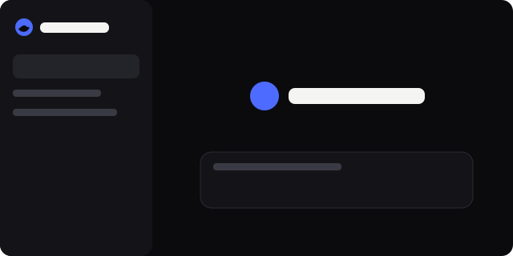

# ohmydsh brand

Makes it obvious you are using **ohmydsh**: the DeepSeek Harness logo and name are replaced by ohmydsh's, and a truthful
credit says what it is built on.

## What changes

| Where | Now shows |
|---|---|
| Sidebar, expanded | the ohmydsh mark and wordmark (the "deepseek HARNESS" lettering is gone) |
| Sidebar, collapsed | the ohmydsh mark |
| New-session screen | the ohmydsh mark before the headline |
| Browser tab | the title `ohmydsh` (your session title stays in front: `My session — ohmydsh`) and the ohmydsh favicon, light and dark |
| Loading screen | `ohmydsh` instead of `HARNESS` |
| Installed phone/desktop app icon | the ohmydsh icon (same icon files the app manifest points at) |
| Settings → General | **ohmydsh · Built on DeepSeek Harness**, linking to DeepSeek's page, plus a note that DeepSeek did not make or endorse ohmydsh |

The mark follows your theme (light, dark, Omarchy, palettes).

## Settings

This plugin has no page. Two switches live in its row in `profile/defaults.cordis.yml`:

- `enabled` (default on): off restores the stock DeepSeek look everywhere.
- `showAttribution` (default on): the Settings credit and the sidebar name tooltip.

## What it cannot change

Words DeepSeek's own screens write in their own text, such as the first-run "Preview Notice", the sign-in dialog and model
or provider names (for example "DeepSeek Flash"). They name the real product or service and are left as they are.
