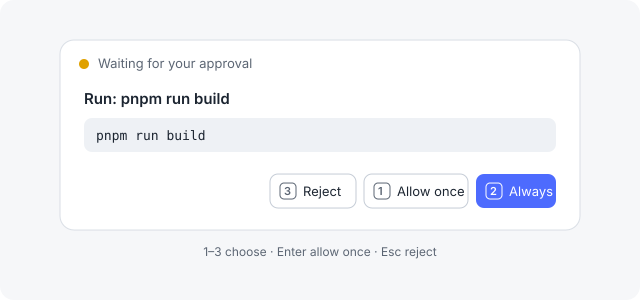

# ohmydsh keys

Answer the cards that wait for you without reaching for the mouse: tool **approvals** and **questions** (the multiple-choice
cards the agent asks).

## Approval card

| Key | Does |
|---|---|
| `1` | Allow once |
| `2` | Always allow (when the card offers it; otherwise `2` rejects) |
| `3` or `Esc` | Reject |
| `Enter` | Allow once (never "always": `Enter` must not grant lasting access) |

Each button shows its number, and a line under the card lists the keys.

## Question card

| Key | Does |
|---|---|
| `1`–`9` | Pick that option (toggle it on a multiple-choice question) |
| `↑` `↓` | Move between the options |
| `Space` | Toggle the focused option (multiple choice) |
| `Enter` | Confirm, or go to the next question |
| `Tab` | Jump to the "Other" box to type your own answer (`Esc` comes back to the options) |
| `←` `→` | Previous or next question, when the agent asked several |
| `Ctrl`+`Backspace` | Skip the question (while you are not typing in the answer box) |

## Getting to the card

When a card appears it takes the keyboard focus, so the keys work at once. It does **not** take it while you are typing:
if you are in the message box and typed in the last second and a half, or the box already holds text, the card shows
"Ctrl+Alt+J to answer" instead. **Ctrl+Alt+J** (**⌘⌥J** on a Mac) jumps to the waiting card from anywhere. Change it in Settings →
Shortcuts.

## Safety

- The keys only work while the focus is inside the card, so digits never end up in your message.
- Held keys do not repeat, and keys pressed while an input method is composing text are ignored.
- The plugin presses the card's own buttons, so DeepSeek Harness still decides what is allowed and answers the right request.
- Only the card you can see, in the pane you are in, reacts. An answered or withdrawn card is never touched.
- On a phone or tablet (no physical keyboard) nothing changes; on narrow windows the hint line is hidden.

## Settings

No page. Two switches in the plugin's row: `enabled` (default on) and `autoFocus` (default on: off means the card never takes
the focus and always shows the `Ctrl+Alt+J` hint).
