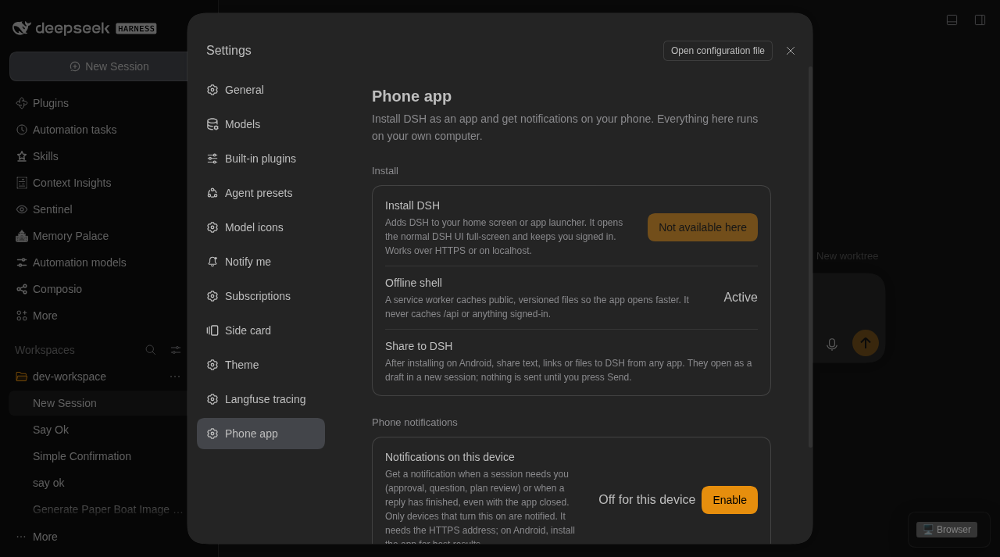

# @t3labs/ohmydsh-pwa

Installs the **normal ohmydsh UI** (it is a DeepSeek Harness plugin; on stock DSH set `name`/`shortName` below) as an app and sends **Web Push notifications** to phones that opt in. English-only UI, no phone-specific page: the installed app is the same interface you use in the browser, opened full-screen and signed in with the same HttpOnly cookie.



| Route | Auth | What it does |
|---|---|---|
| `GET /manifest.webmanifest` | public (browsers fetch it without credentials; no secrets inside) | Replaces the stock manifest: same icons, `start_url: /app`, `scope: /`, `id: /`, `display: standalone`, Android `share_target` |
| `GET /sw.js` | public | Service worker (see below); `Service-Worker-Allowed: /`, never cached by the browser |
| `GET /app`, `/app.js` | public, no secrets, `no-store` | Launch page of the installed app: signs in through a same-origin fetch, then opens `/`, or shows a paste-your-login-link form (see below) |
| `POST /share` | signed in, same-origin | Android share target. Saves text, url and files, answers `303 /?share=<id>`, or JSON `{id}` when the request sends `Accept: application/json` |
| `GET /share?id=` | signed in | The stored share, read by the UI to pre-fill a draft |
| `GET /push/key` | signed in | The VAPID public key |
| `POST /push/subscribe` | signed in, same-origin | Stores this device's `PushSubscription` (keyed by endpoint, with a device label and created time) |
| `POST /push/unsubscribe` | signed in, same-origin | Forgets it |
| `POST /push/test` | signed in, same-origin | Sends one test push to the calling device |

Routing was verified in `dsh-host-webserver`: the match order is exact route, then longest prefix, then the single SPA fallback seat, and a duplicate `(kind, path)` registration throws, so these exact routes cannot silently shadow another plugin.

## Pair a phone (0.3.0)

**Settings > Phone app > Pair a phone** shows a QR code and a copyable link for the ohmydsh Android app ([docs/APPS.md](../../docs/APPS.md)). The code is valid 10 minutes and works once.

| Route | Auth | What it does |
|---|---|---|
| `POST /pair/code` | signed in, same-origin | Issues a one-time code and the best address for a phone (Tailscale HTTPS name, else the LAN address, with warnings) |
| `GET /pair/devices` | signed in | Paired devices (name, created, last seen; never tokens) |
| `POST /pair/remove` | signed in, same-origin | Revokes a device at once |
| `POST /pair/claim` | **public**, rate-limited | `{code, deviceName}` returns a device token (`{mode:'cookie'}` signs a browser in instead) |
| `GET /pair/session` | **public**, `Authorization: Bearer <device token>` | `303 /` with DSH's normal HttpOnly sign-in cookie |
| `GET /app/pair` | public | Landing page of the plain link `https://<address>/app/pair#<code>` (the code stays in the fragment) |

The device token (32 random bytes) is stored only as a SHA-256 hash in `plugin-data/dsh-pwa/devices.json` (0600) and only travels in an `Authorization` header. DSH's launch token is used inside the process and never leaves it. Core's cookie is stateless, so *Remove* is enforced by refusing the cookies minted for that device at core's admission check (all routes, `/api`, the page shell) and closing its WebSockets. Set `pairing: { enabled: false }` to remove all of it. Tests: expiry, single use, rate limit, revocation, constant-time comparison, address choice, and the QR encoder against an independent decoder.

## What the phone has to do

1. Open DSH at its **HTTPS** address (for example Tailscale: `tailscale serve --bg --https=443 http://127.0.0.1:<port>`) or on `localhost`. Plain `http://` to a non-local host is not a secure context: Chrome will not install the app, run the worker or allow push.
2. Open the DSH link with its token once, then Chrome menu > **Install app** (on Android this matters for push: an installed app keeps notifications reliable).
3. In the installed app: **Settings > Phone app > Phone notifications > Enable**, and allow notifications when Android asks. Press **Send test notification** to check.

Nothing asks for permission on page load; only the Enable button does. Only devices that pressed Enable receive pushes, so a desktop that already has `dsh-notify-me` does not get duplicates unless you also enable it there.

## Notifications

What triggers one (the host reads the session event feed with no page open, the same events `dsh-notify-me` uses):

| Trigger | Notification |
|---|---|
| Approval request (`approval/asked`) | **Approval needed**, body = session title + tool + reason |
| A pending `ask_user_question` | **Question for you**, body = session title + the question |
| `exit_plan_mode` (plan review) | **Plan ready for review**, body = session title |
| A reply finished (`turn/end` completed) | Title = session title, body = first ~120 characters of the reply |

Never for subagent sessions, never for turns nobody typed (schedules, triggers, goal rounds), and never for a session in which no person has written (engram/ingest internals, automation). An approval that is decided within 1.5 s (auto-approved) is not sent. Bursts collapse: one notification per session and kind within 8 s, and the notification `tag` is the session id so a newer one replaces the older one on the phone. If a visible, focused window already shows that session, the service worker skips the notification.

The push payload is `{ v, kind, title, body, sessionId }` and nothing else: no tokens, no URLs.

**Why the app opens `/app`.** Core sets the sign-in cookie `HttpOnly; SameSite=Strict`. Chrome treats a launch from the Android home screen as a cross-site navigation, so a request for `/` carries no cookie and core answers `401`. The installed app has no address bar to fix that. `/app` is public and holds no secret; its script calls `/push/key` with a same-origin fetch (cookie sent): signed in, it goes to `/` and passes only `openSession` and `share` (validated ids); signed out, it asks for the login link (a full URL or the bare token), then navigates to `/?token=…` so the server sets the cookie. The token is never stored or logged. Reinstalling is not needed: `id` and `scope` are unchanged, and Chrome refreshes the manifest on its own schedule.

**Opening a session from a notification.** The click handler focuses an existing app window and posts it `{ type: 'dsh-pwa:open-session', sessionId }`; the client half calls `uiWorkspace.openSession(id)`, the host's own navigation service (the same call `dsh-notify-me` uses). With no window open it opens `/app?openSession=<id>`; the client reads that on start, waits for the session list, opens the session and removes the parameter from the address bar.

**Share to ohmydsh.** The share sheet POSTs to `/share` as a cross-site navigation, so the browser withholds the `SameSite=Strict` sign-in cookie. The service worker therefore takes that POST, keeps title, text, url and files in Cache Storage (`dsh-share`, random id, 10 min TTL, cleared once delivered) and redirects to `/app?shareLocal=<id>`; `/app` posts it to `/share` itself (a same-origin fetch, so the cookie is sent) and goes on to `/?share=<id>`. The client fetches it and calls `uiWorkspace.startSession(undefined, { prompt, whenDraftExists: 'append' })`, the same entry the host's New Session flow uses, so the shared text lands in the normal composer as a draft. It is never sent. Shared files are saved under `<share.cwd>/.dsh-shares/<id>/` (or next to the record) and their paths are listed in the draft.

### Keys and storage

`$DSH_HOME/plugin-data/dsh-pwa/` (directory `0700`): `vapid.json` (VAPID key pair, generated once, `0600`; deleting it orphans every subscription), `subscriptions.json` (`0600`, atomic writes), `shares/`. A 404/410 from the push service deletes that subscription. Endpoints and keys are never logged in full (host and last six characters only). Subscription endpoints must be `https` and not a private or loopback host.

## Auth and safety

- Every signed-in route calls `connection.requestRejection(request)` first (Host/Origin fence plus the same HttpOnly cookie as the full UI) and fails closed with 401/403. Mutations additionally require a same-origin `Origin` (or `Sec-Fetch-Site: same-origin|none`) and refuse `cross-site`.
- Bodies are JSON only and capped at 8 KiB.

## The service worker never caches anything private

It answers only `GET` requests for public, content-addressed files: hashed `/assets/*-<hash>.js|css`, plugin bundles requested with `?rev=` and the install icons. For everything else (`/api`, `/plugins/events`, `/abx/*`, `/browser/*`, `/share`, `/push/*`, `/`, the manifest, `/sw.js`) it does not call `respondWith`. Navigations are network-first and never stored (an offline page is shown on failure). It refuses to store any response with `Set-Cookie`, `Cache-Control: no-store|private`, `Vary: *`, non-200 or non-same-origin status, or any request carrying `Authorization`. `serviceWorker: false` serves a kill-switch script that unregisters the worker and clears `dsh-pwa-*` caches. The worker is registered from the host index through a structured `webserver/index-inject` row, and only in a secure context.

## Config (`cordis.patch.yml`)

```yaml
- id: dsh-pwa
  name: '@t3labs/ohmydsh-pwa'
  config:
    name: ohmydsh             # shown in the app pages, offline page and notifications; DeepSeek Harness on stock DSH
    shortName: ohmydsh        # launcher label (max 12 chars); DSH on stock DSH
    startUrl: /app            # launch page: signs in, then opens the normal UI
    themeColor: '#ffffff'
    backgroundColor: '#ffffff'
    serviceWorker: true
    share:
      enabled: true
      cwd: ""                 # where shared files are saved (<cwd>/.dsh-shares/); empty = next to the share record
      maxMiB: 25
    push:
      enabled: true           # false removes the /push routes and the session feed listener
      subject: "mailto:dsh-pwa@localhost.invalid"   # VAPID contact sent to the push service
```

## Upgrading from 0.1

The `/m` phone page is gone. An old `startUrl: /m` falls back to `/app`; delete it, and `share.mode` (ignored now). Reinstall the app on the phone so it picks up the new manifest.

## Develop

`pnpm install && pnpm run check` (typecheck, oxlint, token lint, vitest, build, artifact check). Layout: `src/host/` (routes, VAPID, subscriptions, push sender, event notifier, service worker source), `src/client/` (Settings section, click/share bridge), `src/kit/` (dsh-kit UI copy). `web-push` is a runtime dependency; `scripts/check-artifacts.mjs` fails the build if it does not resolve. `node scripts/verify-dev.mjs` runs the live checks against the dev harness (`127.0.0.1:3090`) in Chromium.

## Not verified

Installation, the share sheet and push delivery to a real Android phone over Tailscale HTTPS. Everything else was checked in Chromium on `127.0.0.1` (a secure context), including real Web Push delivery through Chromium's push service.

## Licence

MIT, see [LICENSE](LICENSE). UI controls in `src/kit/` are adapted from `@deepseek-ai/dsh-client-ui-primitives` (MIT, Copyright (c) 2026 DeepSeek); see [NOTICE](NOTICE). `web-push` is MIT.
