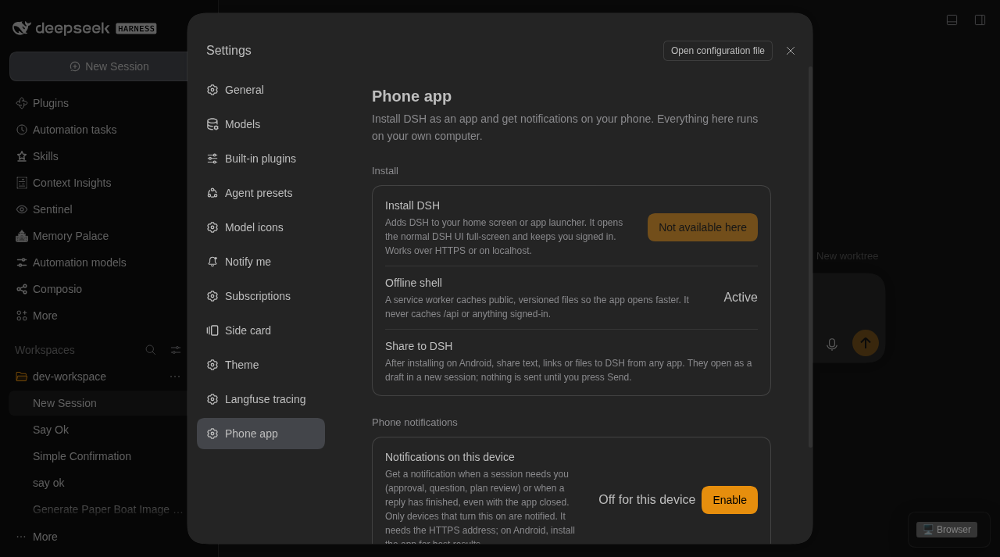

**Phone app** turns ohmydsh into an installable app and sends push notifications to your phone.

- **The normal ohmydsh UI, as an app.** The installed app opens the same interface you use in the browser, full-screen, signed in with the same cookie. There is no separate phone page.
- **Notifications, even with the app closed.** You get a notification when a session needs you (approval, question, plan review) and when a reply has finished. Tapping it opens that session.
- **Only devices that turn it on are notified.** Open Settings > Phone app on the device and press Enable. Use Send test notification to check it.
- **Share to ohmydsh (Android).** Share text, links or files from any app; they open as a draft in a new session. Nothing is sent until you press Send.

It needs the HTTPS address of your ohmydsh (for example Tailscale HTTPS) or localhost. On Android, install the app first for the best results.

A service worker caches only public, versioned files. It never caches `/api` or anything you are signed in to.
