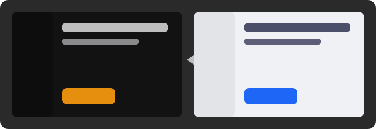

# Theme: Follow Omarchy

DSH takes its colours from the theme your Omarchy desktop is using, and re-colours itself the moment you switch Omarchy themes (about a quarter of a second after `omarchy theme set`). Open **Settings → Theme**.

## Colour source

| Choice | What happens |
|---|---|
| **Stock** | DSH looks exactly as shipped. Nothing is overridden. |
| **Follow Omarchy** | Surfaces, text, borders, accent, links, primary buttons and code highlighting follow Omarchy's current palette. |
| **Palette** | A bundled palette: Catppuccin Mocha/Latte, Dracula, Gruvbox Dark/Light, Solarized Dark/Light, Nord, Tokyo Night, Rosé Pine. |

The page shows which Omarchy theme is being followed and swatches of the colours in use.

## Look and glass

- **Look** (Stock or Endfield) is a separate setting. **Glass** (Off, Subtle, Standard, Strong) makes the composer, the sidebar and the open right panel see-through, with a real blur on the open panel. It works with any look and any colours. Pick it in Settings → Theme → Look → Glass for this browser, or set `glass:` on the `dsh-theme` row for every device. *Profile default* means: Standard with the Endfield look, Off with the Stock look.
- Glass honours *reduce transparency* (opaque, no blur) and falls back to an almost opaque fill where the browser cannot blur.

## Good to know

- **Status colours stay DSH's** (errors, warnings, success) by default, because some Omarchy themes assign those colour keys to other hues. Turn on *Use Omarchy status colours* to follow Omarchy there too.
- **Primary buttons use your Omarchy accent.** DSH's own brand colour is left alone.
- **Meant for this computer.** *Follow Omarchy* is on by default only in the browser on the machine that runs Omarchy. Other devices (your phone, a tablet) open with Stock and follow their own light/dark mode; pick a palette there if you want one. The choice is saved per browser.
- **Your own Appearance setting is never changed.** Omarchy normally sets your desktop to light or dark too, so Appearance *System* matches. If it doesn't, Settings → Theme tells you to set Appearance to System, or to Dark/Light to match; the plugin never changes it for you.
- **Text stays readable.** Palette text colours are nudged to a minimum contrast against the background when an Omarchy theme would be too faint.
- **Disable or Stock removes everything** with a single step: no stylesheet or setting is left behind.
- If Omarchy is not installed, Follow Omarchy says so and DSH stays stock.

## Requirements

DSH 0.2.2-rc.1 or newer. Omarchy is only needed for *Follow Omarchy*; palettes work anywhere. Reads `~/.local/state/omarchy/current` (read-only); it never runs Omarchy commands and never edits Omarchy files.

## Privacy and security

Two read-only local routes (`/api/dsh-theme/omarchy`, `/api/dsh-theme/omarchy/stream`) serve the palette to the open page. They require the same admission as the rest of DSH and refuse requests otherwise. Nothing leaves your machine.

## Credits

Palette selection inspired by [dsh-codex-ui](https://github.com/MichengAI/dsh-codex-ui) (Apache-2.0). See NOTICE.
